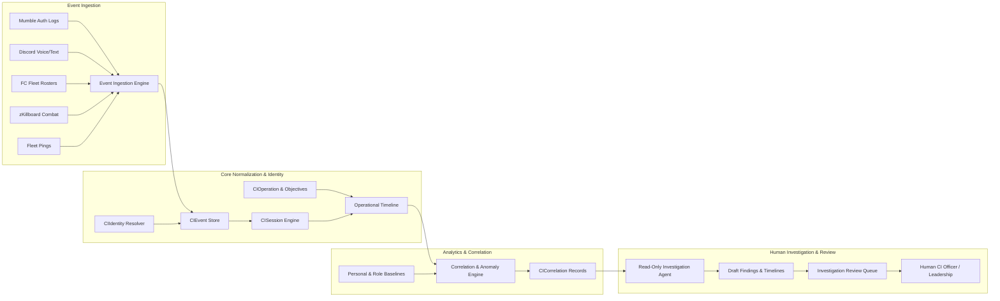

# Requirements

### Overview & Goals
The objective of this initiative is to maximize the operational security and intelligence efficacy of the alliance by establishing an Operational Intelligence and Counterintelligence (CI) system within `aa_bb`. Rather than relying on simplistic, high-error single-metric spy scores that create noise and false accusations, this system provides leadership with rigorous activity correlation across communication channels (Mumble, Discord), fleet operations (FC rosters), combat logs (zKillboard), and historical baselines.

The system empowers counterintelligence officers and leadership to:
1. Reconstruct exact timelines of operations, communication presence, and combat events.
2. Detect statistically significant behavioral anomalies and exposure patterns relative to role and historical baselines.
3. Accelerate incident triage through a controlled, read-only AI investigation assistant that synthesizes evidence timelines and evaluates plausible alternative explanations.

### Scope
#### In Scope
- **Domain Models & Database Architecture**: Normalized storage for CI events, effective-dated identity mappings, communication sessions, operations, objectives, correlation results, investigations, and overrides.
- **Event Ingestion Pipelines**: Idempotent parsers for Mumble authenticator logs, Discord voice/message events, zKillboard combat records, and fleet pings.
- **Strictly Authoritative FC Rosters**: Read-only ingestion of FC-submitted PAP / AFAT fleet rosters as the sole basis of confirmed fleet participation, requiring zero member participation or self-reporting.
- **Correlation & Anomaly Detection Engine**: Multi-dimensional correlation covering operation-to-activity coverage, personal baseline shifts, role-aware comparisons, and historical incident replay.
- **Read-Only AI Investigation Assistant**: Agentic workflow to assemble multi-source timelines, evaluate confounding factors (e.g., scouting roles, connection drops), and draft reviewable findings.
- **User Interface & Workflows**: Operation Timeline Dashboard, Member Activity History View, and Investigation Review Queue restricted by granular permissions (`can_view_ci`, `can_manage_ci`, `can_review_ci`).
- **Celery Task Architecture**: Dedicated, isolated task queues ensuring heavy historical replay and correlation processing never disrupt regular audit loops.

#### Out of Scope
- Automated punitive actions (e.g., auto-kicking, automated blacklisting, or automated role revocation). All outcomes require human review and discretion.
- Member-facing interaction or self-reporting forms.
- Recording or storing message content or voice audio streams (metadata and presence only).
- Replacing standard Alliance Auth character auditing or general compliance tickets.

### User Stories
- **As a Counterintelligence Officer**, I want to reconstruct the complete operational timeline for a compromised fleet so that I can identify communication overlaps and potential intelligence leaks with verifiable evidence.
- **As an Alliance Leader**, I want to analyze whether an apparent anomaly (e.g., a member disconnecting before hostile contact) is a recurring habit or an unusual outlier relative to normal baseline behavior.
- **As a Fleet Commander (FC)**, I want to submit fleet rosters and associate fleets with operational objectives without imposing any administrative burden on fleet participants.
- **As an Investigator**, I want an AI assistant to aggregate disparate logs into an evidence timeline with confidence metrics and alternative hypotheses so that triage time is minimized and investigator cognitive load is optimized.

### Functional Requirements
- **FR-1: Identity Resolution with Historical Effective Dates**: Map EVE characters, Alliance Auth user profiles, Discord accounts, and Mumble usernames with timestamps to ensure accurate retroactive attribution even when usernames or memberships change.
- **FR-2: Read-Only FC Fleet Roster Processing**: Ingest fleet rosters solely from FC submissions. Members must never be asked or allowed to self-report attendance.
- **FR-3: Operational Objective Tagging**: Support objective tagging (e.g., `Strategic Defense`, `Capital Deployment`, `QRF`, `Recon`, `Logistics`, `Combat Fleet`, `Strategic Briefing`) to evaluate participation in context (e.g., logistics and scouts are not expected on killmails; briefing attendees are not expected in combat).
- **FR-4: Multi-Source Event Correlation**: Align Mumble connection/channel sessions, Discord voice activity, zKillboard killmails, fleet announcements, and PAP rosters within flexible operational windows.
- **FR-5: Anomaly Classification & Confidence Scoring**: Classify discrepancies (e.g., Comms without PAP, Repeated Short Sessions, Strategic Briefing Attendance without Combat Deployment) with confidence scores and data-completeness ratings rather than arbitrary 1–10 spy scores.
- **FR-6: Historical Incident Replay**: Enable investigators to select specific historical incidents and run correlation algorithms against recorded events to test hypotheses across both successful and compromised operations.
- **FR-7: Read-Only Investigation Assistant**: Provide an agent that constructs an incident timeline, lists supporting sources, flags data gaps, and drafts review findings for authorized reviewers.
- **FR-8: Dedicated Access Control**: Enforce strict permissions (`can_view_ci`, `can_manage_ci`, `can_review_ci`) preventing CI records and investigations from leaking to general audit or ticket users.

### Non-Functional Requirements
- **Performance & Scalability**: Ingestion and correlation tasks must run asynchronously on a dedicated Celery queue (`aa_bb_ci`) without increasing character audit latency.
- **Data Integrity & Idempotency**: Ingestion jobs must support idempotent replay using deterministic hashing and event deduplication keys.
- **Auditability & Reproducibility**: Correlation results must store algorithm version, source event IDs, timestamp, and completeness metrics to guarantee repeatable findings.
- **Privacy & Security**: Zero capture of message content or audio recordings; strict data retention policies for raw communication sessions and completed investigation cases.

# Technical Design

### Current Implementation
The existing `aa_bb` application provides a robust audit foundation:
- `UserStatus` and `CorpStatus` models (`aa_bb/models.py`) store aggregated risk indicators and periodic check summaries.
- `PapsConfig` and `PapCompliance` manage PAP compliance rules and monthly scoring.
- Discord activity tracking (`last_discord_message_at`) is monitored via `tasks_bot.py` and `tasks_tickets.py`.
- zKillboard and ESI integrations (`aa_bb/checks/awox.py`, `aa_bb/providers.py`) handle rate-limited external data collection.
- Celery beat tasks (`aa_bb/celery.py`, `aa_bb/tasks*.py`) manage background scheduling.

However, the existing setup does not maintain longitudinal communication session timelines, operational event windows, or cross-source correlation capabilities.

### Key Decisions
- **Decision 1: Modular Sub-Package Architecture (`aa_bb/counterintel/`)**
  *Approach*: House all counterintelligence models, services, tasks, and views in a dedicated submodule `aa_bb/counterintel/` within the `aa_bb` Django application.
  *Rationale*: Maximizes maintainability, isolates complex CI query logic from standard audit routines, and facilitates clean permission and URL encapsulation.

- **Decision 2: Authoritative FC Roster Model (No Member Self-Reporting)**
  *Approach*: Treat FC-submitted fleet rosters as the single authoritative source of confirmed fleet participation.
  *Rationale*: Minimizes operational friction, eliminates member deception vectors, and ensures total operational utility without requiring member-side compliance actions.

- **Decision 3: Multi-Source Temporal Correlation vs. Single Metric Scoring**
  *Approach*: Store explicit event intervals, session bounds, and versioned correlation findings with confidence and completeness metrics instead of a single 1–10 spy score.
  *Rationale*: Reduces false positives, accounts for legitimate operational roles (logistics, scouts, briefing attendees), and preserves evidentiary integrity for human review.

- **Decision 4: Tool-Constrained Read-Only Investigation Agent**
  *Approach*: Restrict the agentic component to read-only queries against normalized CI tables, generating draft findings and timeline syntheses.
  *Rationale*: Ensures AI serves as a high-efficiency cognitive accelerator for human officers without introducing risks of automated, erroneous punitive actions.

### Architecture Diagram


### Data Models / Contracts
Key models located in `aa_bb/counterintel/models.py`:

```python
class CIIdentity(models.Model):
    user = models.ForeignKey(User, on_delete=models.CASCADE, related_name="ci_identities")
    character_id = models.BigIntegerField(null=True, blank=True, db_index=True)
    discord_id = models.BigIntegerField(null=True, blank=True, db_index=True)
    mumble_username = models.CharField(max_length=255, null=True, blank=True, db_index=True)
    effective_from = models.DateTimeField(default=timezone.now, db_index=True)
    effective_until = models.DateTimeField(null=True, blank=True, db_index=True)
    is_verified = models.BooleanField(default=False)

class CIOperation(models.Model):
    name = models.CharField(max_length=255)
    operation_type = models.CharField(max_length=64, default="strategic")
    start_time = models.DateTimeField(db_index=True)
    end_time = models.DateTimeField(null=True, blank=True, db_index=True)
    fleet_commander = models.ForeignKey(User, on_delete=models.SET_NULL, null=True, blank=True)
    secrecy_level = models.CharField(max_length=32, default="standard")
    notes = models.TextField(blank=True)
    created_at = models.DateTimeField(auto_now_add=True)

class CIOperationObjective(models.Model):
    operation = models.ForeignKey(CIOperation, on_delete=models.CASCADE, related_name="objectives")
    name = models.CharField(max_length=255)
    objective_type = models.CharField(max_length=64)  # strategic_defense, capital, qrf, recon, logi, combat, briefing
    expected_roles = models.JSONField(default=list, blank=True)
    disclosure_time = models.DateTimeField(null=True, blank=True)

class CIOperationParticipant(models.Model):
    operation = models.ForeignKey(CIOperation, on_delete=models.CASCADE, related_name="participants")
    user = models.ForeignKey(User, on_delete=models.CASCADE, related_name="ci_participations")
    character_id = models.BigIntegerField(db_index=True)
    confirmed_by_fc = models.BooleanField(default=True)
    recorded_at = models.DateTimeField(default=timezone.now)

class CIEvent(models.Model):
    source = models.CharField(max_length=64, db_index=True)  # mumble, discord, zkill, pap, ping
    source_event_id = models.CharField(max_length=255, db_index=True)
    timestamp = models.DateTimeField(db_index=True)
    user = models.ForeignKey(User, on_delete=models.SET_NULL, null=True, blank=True, related_name="ci_events")
    operation = models.ForeignKey(CIOperation, on_delete=models.SET_NULL, null=True, blank=True, related_name="events")
    payload = models.JSONField(default=dict)
    dedup_hash = models.CharField(max_length=64, unique=True)

class CISession(models.Model):
    source = models.CharField(max_length=64)  # mumble, discord
    user = models.ForeignKey(User, on_delete=models.CASCADE, related_name="ci_sessions")
    start_time = models.DateTimeField(db_index=True)
    end_time = models.DateTimeField(null=True, blank=True, db_index=True)
    channel_name = models.CharField(max_length=255, blank=True)
    reconnect_count = models.PositiveIntegerField(default=0)

class CICorrelation(models.Model):
    operation = models.ForeignKey(CIOperation, on_delete=models.CASCADE, related_name="correlations")
    user = models.ForeignKey(User, on_delete=models.CASCADE, related_name="ci_correlations")
    anomaly_type = models.CharField(max_length=64)
    confidence = models.FloatField(default=0.0)
    data_completeness = models.FloatField(default=1.0)
    algorithm_version = models.CharField(max_length=32)
    source_event_ids = models.JSONField(default=list)
    explanation = models.TextField()
    computed_at = models.DateTimeField(auto_now_add=True)

class CIInvestigation(models.Model):
    STATUS_CHOICES = [
        ("pending", "Needs Review"),
        ("in_review", "Under Investigation"),
        ("cleared", "Cleared / Explained"),
        ("escalated", "Escalated"),
        ("dismissed", "Dismissed"),
    ]
    operation = models.ForeignKey(CIOperation, on_delete=models.SET_NULL, null=True, blank=True)
    subject_user = models.ForeignKey(User, on_delete=models.CASCADE, related_name="ci_investigations")
    status = models.CharField(max_length=32, choices=STATUS_CHOICES, default="pending")
    assigned_reviewer = models.ForeignKey(User, on_delete=models.SET_NULL, null=True, blank=True, related_name="assigned_ci_cases")
    agent_summary = models.TextField(blank=True)
    reviewer_notes = models.TextField(blank=True)
    created_at = models.DateTimeField(auto_now_add=True)
    updated_at = models.DateTimeField(auto_now=True)

class CIOverride(models.Model):
    user = models.ForeignKey(User, on_delete=models.CASCADE, related_name="ci_overrides")
    reason = models.TextField()
    exempt_anomaly_types = models.JSONField(default=list)
    created_by = models.ForeignKey(User, on_delete=models.SET_NULL, null=True)
    created_at = models.DateTimeField(auto_now_add=True)
```

### File Structure
```
aa_bb/
├── counterintel/
│   ├── __init__.py
│   ├── admin.py
│   ├── apps.py
│   ├── models.py
│   ├── urls.py
│   ├── views.py
│   ├── ingest/
│   │   ├── __init__.py
│   │   ├── mumble.py
│   │   ├── discord.py
│   │   ├── paps.py
│   │   └── zkill.py
│   ├── services/
│   │   ├── __init__.py
│   │   ├── identity.py
│   │   ├── operations.py
│   │   ├── correlation.py
│   │   ├── baseline.py
│   │   └── agent.py
│   └── tasks.py
├── templates/
│   └── aa_bb/
│       └── counterintel/
│           ├── base.html
│           ├── operation_timeline.html
│           ├── member_activity.html
│           └── review_queue.html
└── tests/
    ├── test_ci_models_ingest.py
    ├── test_ci_operations.py
    ├── test_ci_correlation.py
    └── test_ci_investigation.py
```

### Risks
- **Risk 1: Log Gaps & Disconnect Volatility**: Missing Mumble disconnect events or network drops could mimic intentional disconnects.
  *Mitigation*: Implement session gap detection, track network reconnect clustering, and factor data-completeness metrics directly into correlation confidence calculations.
- **Risk 2: Role-Based False Positives**: Scouts, logistics, and cyno pilots rarely appear on killmails despite active participation.
  *Mitigation*: Support operation objective tagging and role awareness; automatically suppress combat absence anomalies for verified support roles.
- **Risk 3: Performance Degradation from Historical Replays**: Complex multi-month correlation across thousands of communication logs could lock database workers.
  *Mitigation*: Route all CI correlation and historical replay tasks to a dedicated Celery queue (`aa_bb_ci`) with indexed database queries and batch processing.

# Testing

### Validation Approach
Verification focuses on deterministic accuracy of identity resolution, event ingestion idempotency, mathematical correctness of correlation baselines, and strict access control isolation. Validation is conducted through automated Django unit and integration test suites using mock data generators for Mumble logs, Discord gateway events, and zKillboard feeds.

### Key Scenarios
- **Scenario 1: FC Fleet Roster Processing (Authoritative Ingestion)**
  *Test*: Ingest an FC-submitted roster with character names and timestamps.
  *Expected Outcome*: `CIOperationParticipant` records are created and linked to resolved `UserProfile` objects without triggering any member-facing notification or requiring member action.
- **Scenario 2: Comms Presence vs. Roster Attendance Mismatch**
  *Test*: Simulate 10 members in Mumble comms during a 2-hour strategic fleet window where only 6 are on the FC roster.
  *Expected Outcome*: The 4 uncredited members are recorded as attendance mismatches with `data_completeness` and session duration metrics.
- **Scenario 3: Role-Aware Killmail Correlation**
  *Test*: Correlate killmails for an operation where a member is marked with a `Logistics` or `Recon` objective vs. a `Combat Fleet` objective.
  *Expected Outcome*: Absence from killmails triggers an anomaly only for combat roles, while support roles are marked compliant with role context.
- **Scenario 4: Personal Baseline & Pre-Contact Disconnect Detection**
  *Test*: Replay an incident where a member disconnects 8 minutes prior to hostile fleet contact. Compare against their 60-day historical disconnect pattern.
  *Expected Outcome*: Anomaly confidence is high if the member rarely disconnects at that time, and low if it coincides with regular daily logoff habits.
- **Scenario 5: Read-Only Investigation Agent Synthesis**
  *Test*: Execute `CIAgentService.generate_case_findings()` for an anomalous operation.
  *Expected Outcome*: Produces structured Markdown findings, chronological event links, highlighted data uncertainties, and sets case status to `Needs Review` without altering user standings or permissions.

### Edge Cases
- **Mumble Username Renames & Discord Unlinking**: Verify that events occurring before an account unlinking remain correctly mapped to historical `CIIdentity` records based on the effective date range.
- **Duplicate Log Ingestion**: Re-running Mumble log parsing on the same file chunk must produce zero duplicate `CIEvent` or `CISession` entries due to `dedup_hash` uniqueness.
- **Simultaneous Fleet Overlaps**: Validate that pilots in multiple concurrent or back-to-back fleets are correlated against their specific operational windows without cross-fleet pollution.

### Test Changes
- `aa_bb/tests/test_ci_models_ingest.py`: Model constraints, foreign keys, deduplication hashes, and Mumble/Discord ingestion parsing.
- `aa_bb/tests/test_ci_operations.py`: Operation creation, FC roster association, objective tagging, and timeline window computation.
- `aa_bb/tests/test_ci_correlation.py`: Correlation engine accuracy, baseline comparison algorithms, and confidence scoring.
- `aa_bb/tests/test_ci_investigation.py`: Investigation agent timeline assembly, reviewer workflows, override handling, and permission restrictions.

# Delivery Steps

### ✓ Step 1: Core Models, Identity Mapping, and Event Ingestion Engine
Database models, identity resolution pipelines, and ingestion workers for Mumble and Discord communication logs are fully operational.

- Create the `aa_bb/counterintel` module package and define core Django models: `CIEvent`, `CIIdentity`, `CISession`, `CIOperation`, `CIOperationObjective`, `CIOperationParticipant`, `CICorrelation`, `CIInvestigation`, and `CIOverride` in `aa_bb/counterintel/models.py`.
- Implement `IdentityResolver` service in `aa_bb/counterintel/services/identity.py` supporting time-effective mappings across EVE Character IDs, Alliance Auth User IDs, Discord Snowflake IDs, and Mumble usernames.
- Build idempotent Mumble log parser (`MumbleLogIngestor`) and Discord voice/message session tracking hooks in `aa_bb/counterintel/ingest/`.
- Configure database migrations and register CI permissions (`can_view_ci`, `can_manage_ci`, `can_review_ci`) in `aa_bb/models.py` and `aa_bb/auth_hooks.py`.
- Add unit tests in `aa_bb/tests/test_ci_models_ingest.py` covering model constraints, identity reconciliation, and ingestion idempotency.

### ✓ Step 2: Operation Management and Fleet Roster Integration
Operation management and read-only fleet roster ingestion pipelines are connected to independent activity streams.

- Implement `CIOperationService` in `aa_bb/counterintel/services/operations.py` to create and track operations, time windows, and optional FC objective classifications (`Strategic Defense`, `Capital Deployment`, `QRF`, `Recon`, `Logistics`, `Combat Fleet`, `Strategic Briefing`).
- Integrate FC-submitted PAP / AFAT fleet rosters in read-only mode via `aa_bb/counterintel/ingest/paps.py`, ensuring fleet credit is exclusively derived from FC rosters with zero member self-reporting.
- Implement zKillboard combat event enrichment for operational windows with rate-limiting and local caching in `aa_bb/counterintel/ingest/zkill.py`.
- Build the Operation Timeline View and Member CI Activity History dashboard in `aa_bb/counterintel/views.py` and templates under `aa_bb/templates/aa_bb/counterintel/`.
- Add test suites in `aa_bb/tests/test_ci_operations.py` verifying roster ingestion, window alignment, and timeline reconstruction.

### ✓ Step 3: Correlation Engine and Behavioral Anomaly Detection
The versioned correlation engine detects operational anomalies and computes baseline divergences.

- Build `CorrelationEngine` in `aa_bb/counterintel/services/correlation.py` implementing four analytical dimensions: Operation-to-Activity overlap, Personal Baseline Comparison, Role-Aware Participation, and Historical Event Replay.
- Implement classification rules for anomalies (e.g., Comms presence without PAP credit, repeated fleet-time disconnects, tactical briefing presence without deployment) with calibrated confidence metrics.
- Create background Celery tasks in `aa_bb/counterintel/tasks.py` isolated on a dedicated counterintel queue with scheduled and on-demand replay triggers.
- Implement Admin interfaces and Django REST/AJAX endpoints for filtering and inspecting correlation records.
- Add test suites in `aa_bb/tests/test_ci_correlation.py` validating false-positive suppression, baseline drift calculation, and replay reproducibility.

### ✓ Step 4: Investigation Agent and Review Queue Dashboard
Investigators can triage cases, trigger agentic evidence synthesis, and record reviewed findings with audit integrity.

- Implement the read-only `CIAgentService` in `aa_bb/counterintel/services/agent.py` to aggregate multi-source timelines, evaluate alternative hypotheses (log gaps, scout/logi roles, time-zone disconnects), and generate structured draft findings.
- Build the Investigation Review Queue dashboard in `aa_bb/counterintel/views.py` with case management workflows (triage, reviewer notes, disposition status, and audit overrides).
- Restrict investigation visibility strictly to authorized personnel holding `can_review_ci` permissions, isolating CI cases from standard compliance tickets.
- Add comprehensive end-to-end test cases in `aa_bb/tests/test_ci_investigation.py` covering case creation, timeline generation, reviewer disposition, and permission enforcement.